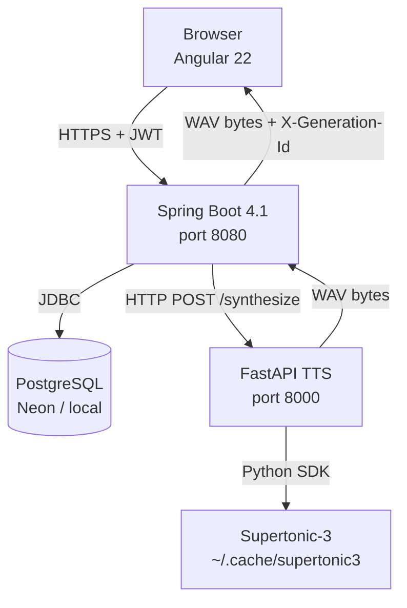

# Words2Voice — Hindi/Hinglish Text-to-Speech Platform - 
(https://youtu.be/vdj-TANClWE - DEMO)

A full-stack web application that converts Hindi, English, and Hinglish text into natural-sounding speech using the Supertonic-3 on-device diffusion model. The system is composed of three independently deployable services: an Angular frontend, a Spring Boot REST API, and a FastAPI TTS inference engine.

---

## Problem Statement

Most commercial TTS services have poor support for code-switched Hindi-English ("Hinglish") text — the natural way millions of people write and speak informally in India. Words2Voice addresses this by running Supertonic-3, a diffusion-based model with native Hindi and Hinglish support, entirely on-device (no third-party API calls, no per-character billing for the operator).

---

## Key Features

The following features have been verified in the source code:

- **Hindi / English / Hinglish synthesis** — `lang` parameter accepts `hi`, `en`, or `na` (auto-detect / Hinglish). The TTS service validates all three language modes via Pydantic.
- **10 voice presets** — 5 male (M1–M5) and 5 female (F1–F5) voices, stored in the `voice` database table and seeded via `data.sql`.
- **Adjustable quality** — `total_steps` (1–40 diffusion steps) trades speed for audio richness.
- **User accounts** — JWT-based registration and login; passwords hashed with BCrypt.
- **Daily usage quota** — configurable per-user character limit enforced server-side (`usage_daily` table).
- **Generation history** — paginated list of past generations with like/unlike and delete; audio files persisted on disk.
- **Projects** — authenticated users can organise generations into named projects.
- **Public voice preview** — unauthenticated users can generate a short preview (rate-limited to 30 requests/hour per IP).
- **Concurrency control** — a configurable semaphore (default 3 permits) prevents TTS engine overload.
- **IP-hashed analytics** — session and event tracking stored in PostgreSQL with SHA-256 hashed IPs.
- **Admin dashboard** — role-protected endpoints for platform stats, top voice usage, daily trends, contact submissions, and analytics summaries.
- **Monetisation interest signals** — authenticated users can submit willingness-to-pay responses.
- **Keep-alive utility** — `keep_alive.py` pings the Render.com health endpoint on a 40-second interval to prevent free-tier spin-down.
- **Cloudflare Tunnel support** — `setup-tunnel.sh` exposes the locally-running TTS service over a public HTTPS URL for production use.

---

## Technology Stack

| Layer | Technology | Version |
|---|---|---|
| **Frontend** | Angular (standalone components, Signals) | 22.x |
| **Frontend language** | TypeScript | ~6.0 |
| **Frontend build** | Angular CLI / esbuild | 22.x |
| **Frontend testing** | Vitest + jsdom | 4.x |
| **Backend** | Spring Boot | 4.1.0 |
| **Backend language** | Java | 17 |
| **Backend security** | Spring Security + JJWT | 0.11.5 |
| **Backend persistence** | Spring Data JDBC | — |
| **Backend retry** | Spring Retry | 2.0.12 |
| **Database** | PostgreSQL | — |
| **TTS service** | FastAPI + Uvicorn | >=0.115 / >=0.30 |
| **TTS model** | Supertonic-3 (diffusion, ONNX) | >=1.3.1 |
| **Audio I/O** | soundfile + NumPy | >=0.12 / >=1.24 |
| **Frontend host (prod)** | Cloudflare Pages / Vercel | — |
| **Backend host (prod)** | Render.com (Docker) | — |
| **Database host (prod)** | Neon (serverless PostgreSQL) | — |
| **TTS host (prod)** | Oracle Cloud Always Free VM + Cloudflare Tunnel | — |

---

## System Architecture

```
+-------------------------------------------------------------+
|                        Browser                              |
|              Angular SPA  (port 4200 / CDN)                 |
|   - JWT attached via HTTP interceptor                       |
|   - API calls routed to Spring Boot via apiBaseUrl          |
+----------------------+--------------------------------------+
                       |  HTTPS  (Authorization: Bearer <jwt>)
                       v
+-------------------------------------------------------------+
|               Spring Boot API  (port 8080)                  |
|   - JWT filter validates every protected request            |
|   - Semaphore limits concurrent TTS calls (default: 3)      |
|   - Daily quota enforced per user                           |
|   - Audio WAV files saved to local disk / /tmp              |
|   - PostgreSQL via Spring Data JDBC                         |
+----------------------+--------------------------------------+
                       |  HTTP POST /synthesize
                       |  (plain JSON, no auth required)
                       v
+-------------------------------------------------------------+
|          FastAPI TTS Service  (port 8000)                   |
|   - Supertonic-3 model loaded at startup                    |
|   - Single Uvicorn worker (model is not thread-safe)        |
|   - Returns raw WAV bytes (audio/wav)                       |
|   - MOCK_TTS=true mode for development without model        |
+----------------------+--------------------------------------+
                       |  Python SDK call
                       v
         Supertonic-3 model (~/.cache/supertonic3)
         ONNX runtime — no GPU required
```

**Data flow for authenticated generation:**

1. The Angular frontend sends `POST /api/tts/generate` with a JWT in the `Authorization` header.
2. `JwtAuthFilter` validates the token; `TtsGenerationService` enforces the character limit and daily quota.
3. The service acquires a semaphore slot (waits up to 20 seconds; returns 503 if full).
4. `SupertonicClient` serialises a JSON request and calls `POST /synthesize` on the FastAPI service (120-second timeout, up to 5 retries on 5xx).
5. The returned WAV bytes are written to disk by `AudioStorageService` and a `generation` row is created.
6. The WAV bytes are returned directly to the browser with an `X-Generation-Id` response header.

---

## Architecture Diagram



---

## Project Structure

```
TTS-Website/
├── frontend/                   Angular 22 SPA
│   └── src/
│       ├── app/
│       │   ├── core/
│       │   │   ├── auth/       JWT interceptor, auth guard, auth service
│       │   │   ├── analytics/  Client-side event tracking
│       │   │   ├── theme/      Theme management
│       │   │   └── toast/      Toast notification service
│       │   ├── features/
│       │   │   ├── auth/       Login and signup components
│       │   │   ├── studio/     Main TTS generation UI + StudioStateService
│       │   │   ├── history/    Generation history list
│       │   │   ├── projects/   Project management
│       │   │   ├── settings/   User profile and password change
│       │   │   ├── dashboard/  Dashboard shell component
│       │   │   ├── voice-lab/  Voice exploration (route exists; content TBD)
│       │   │   └── admin/      Admin panel component
│       │   ├── landing/        Public landing page
│       │   ├── about/          About page
│       │   ├── contact/        Contact form page
│       │   ├── privacy/        Privacy policy page
│       │   └── terms/          Terms of service page
│       └── environments/       environment.ts (dev) / environment.prod.ts (prod)
│
├── backend/                    Spring Boot 4.1 REST API
│   └── src/main/
│       ├── java/com/voisetu/backend/
│       │   ├── client/         SupertonicClient — HTTP client for FastAPI TTS
│       │   ├── config/         AppProperties (@ConfigurationProperties)
│       │   ├── controller/     14 REST controllers (see API section)
│       │   ├── dto/            Request and response records
│       │   ├── exception/      Typed exceptions + GlobalExceptionHandler
│       │   ├── model/          AppUser record
│       │   ├── repository/     AppUserRepository, DashboardRepository
│       │   ├── security/       JwtService, JwtAuthFilter, SecurityConfig
│       │   └── service/        TtsGenerationService, ProjectService, etc.
│       └── resources/
│           ├── application.yml     Multi-profile config (local / prod)
│           ├── schema.sql          DDL — runs at startup via Spring SQL init
│           └── data.sql            Voice preset seed data
│
├── tts-service/                FastAPI TTS inference service
│   ├── main.py                 All endpoints: /health, /voices, /estimate, /synthesize
│   ├── requirements.txt        Python dependencies
│   ├── start-tts-service.sh    Dev launcher (uses supertonic-env venv)
│   ├── setup-tunnel.sh         Cloudflare Tunnel provisioning for prod
│   ├── setup-cloudflared-service.sh  systemd service installation
│   └── Dockerfile              For containerised deployment
│
├── supertonic-env/             Python venv (not committed; created locally)
├── keep_alive.py               Prevents Render.com free-tier spin-down
└── e2e-tests/                  End-to-end test skeleton (empty)
```


## API Documentation

### TTS Service (FastAPI — port 8000)

| Method | Path | Auth | Description |
|---|---|---|---|
| `GET` | `/health` | None | Engine liveness; returns `ready` boolean and uptime |
| `GET` | `/voices` | None | List all 10 voice presets |
| `POST` | `/estimate` | None | Estimate synthesis time in seconds |
| `POST` | `/synthesize` | None | Generate WAV audio |

**`POST /synthesize` request body:**

```json
{
  "text": "Hello! Aaj ka din bahut अच्छा है।",
  "voice_id": "F1",
  "lang": "na",
  "speed": 1.0,
  "total_steps": 8,
  "silence_duration": 0.3
}
```

| Field | Type | Default | Range | Notes |
|---|---|---|---|---|
| `text` | string | — | 1–5000 chars | Hindi / English / Hinglish |
| `voice_id` | string | `M1` | M1–M5, F1–F5 | Voice preset |
| `lang` | string | `null` -> `na` | `hi`, `en`, `na` + others | `na` = auto / Hinglish |
| `speed` | float | `1.0` | 0.7–2.0 | Speaking rate multiplier |
| `total_steps` | int | `8` | 1–40 | Diffusion steps; higher = richer |
| `silence_duration` | float | `0.3` | 0.0–2.0 | Pause between chunks (s) |

**Response:** `audio/wav` binary — 16-bit PCM at the model's native sample rate. Response headers include `X-Audio-Duration` and `X-Synthesis-Time`.

```bash
curl -X POST http://127.0.0.1:8000/synthesize \
  -H "Content-Type: application/json" \
  -d '{"text":"Hello! Aapka swagat hai.","voice_id":"M1","lang":"na","speed":1.0,"total_steps":8}' \
  -o output.wav
```

**Swagger UI:** http://127.0.0.1:8000/docs

---

### Spring Boot API (port 8080)

**Public endpoints (no JWT required):**

| Method | Path | Description |
|---|---|---|
| `POST` | `/api/auth/register` | Register; returns JWT + user info |
| `POST` | `/api/auth/login` | Login; returns JWT + user info |
| `GET` | `/api/public/tts/voices` | List available voices from DB |
| `POST` | `/api/public/tts/preview` | Unauthenticated TTS preview (rate-limited) |
| `POST` | `/api/public/analytics/events` | Ingest client analytics events |
| `POST` | `/api/public/contact` | Submit contact form (rate-limited) |
| `GET` | `/actuator/health` | Spring Boot health check |

**Authenticated endpoints (JWT required):**

| Method | Path | Description |
|---|---|---|
| `POST` | `/api/tts/generate` | Generate TTS audio; returns WAV bytes |
| `GET` | `/api/generations` | Paginated history (`?page=0&size=50&projectId=...`) |
| `DELETE` | `/api/generations/{id}` | Delete a generation and its audio file |
| `GET` | `/api/generations/{id}/audio` | Stream a saved WAV file |
| `POST` | `/api/generations/{id}/like` | Toggle like on a generation |
| `GET` | `/api/projects` | List user's projects |
| `POST` | `/api/projects` | Create a project |
| `PATCH` | `/api/projects/{id}` | Rename a project |
| `DELETE` | `/api/projects/{id}` | Delete a project |
| `GET` | `/api/usage/today` | Current-day character usage and limit |
| `GET` | `/api/me` | Get own profile |
| `PATCH` | `/api/me` | Update display name |
| `POST` | `/api/me/change-password` | Change password |
| `DELETE` | `/api/me` | Delete account (cascades audio files) |
| `POST` | `/api/interest` | Submit monetisation interest signal |

**Admin-only endpoints (`ADMIN` role required):**

| Method | Path | Description |
|---|---|---|
| `GET` | `/api/admin/stats` | Platform-wide generation and user stats |
| `GET` | `/api/admin/top-voices` | Top 20 voices by generation count |
| `GET` | `/api/admin/recent-users` | 50 most recently registered users |
| `GET` | `/api/admin/daily-stats` | Daily generation stats (last 30 days) |
| `GET` | `/api/admin/contacts` | Last 100 contact form submissions |
| `GET` | `/api/admin/analytics-summary` | 7-day event and visitor summary |

**`POST /api/tts/generate` request body:**

```json
{
  "text": "Aapka swagat hai.",
  "voiceId": "M2",
  "lang": "hi",
  "speed": 1.0,
  "totalSteps": 16,
  "projectId": null
}
```

**Response:** `audio/wav` binary. Response header `X-Generation-Id` contains the new generation's database ID.

---

## Database Design

Schema is defined in `backend/src/main/resources/schema.sql` and applied at every startup via Spring's `spring.sql.init.mode: always`.

| Table | Purpose |
|---|---|
| `app_user` | Registered users — email, BCrypt password hash, display name, admin flag |
| `voice` | Voice presets seeded from `data.sql` (engine_voice_id, display_name, gender, style_tag) |
| `project` | User-owned groupings for generations |
| `generation` | Each TTS synthesis attempt — text, char count, audio path, status, duration |
| `usage_daily` | Per-user daily character and generation count for quota enforcement |
| `contact_message` | Contact form submissions |
| `interest_signal` | Willingness-to-pay responses from authenticated users |
| `analytics_session` | Visitor sessions with hashed IP, device, browser, referrer |
| `analytics_event` | Named events linked to sessions (JSONB properties) |
| `synthesis_metric` | Per-generation performance metrics (RTF, synthesis_ms, quality steps) |
| `site_daily_stats` | Aggregated daily platform-level metrics for fast reporting |

**Key relationships:**
- `generation` -> `app_user` (nullable; anonymous previews have no user)
- `generation` -> `project` (nullable; generations can exist outside projects)
- `generation` -> `voice`
- `usage_daily` -> `app_user`
- `analytics_event` -> `analytics_session`
- `synthesis_metric` -> `generation`

---

## Setup and Installation

### Prerequisites

| Tool | Required version |
|---|---|
| Java | 17+ |
| Maven | 3.9+ (or use `./mvnw`) |
| Node.js | LTS (npm 11+) |
| Python | 3.10+ |
| PostgreSQL | 14+ |

---

### 1 — TTS Service (must start first)

The TTS service requires the `supertonic-env` Python virtual environment to be created once:

```bash
# One-time setup
python3 -m venv supertonic-env
supertonic-env/bin/pip install supertonic fastapi "uvicorn[standard]" soundfile numpy pydantic

# Start the service
cd tts-service
./start-tts-service.sh          # default port 8000
# or: ../supertonic-env/bin/uvicorn main:app --host 127.0.0.1 --port 8000
```

The first run downloads Supertonic-3 model files to `~/.cache/supertonic3`. Subsequent starts load from cache.

Verify the service is ready:

```bash
curl http://127.0.0.1:8000/health
# -> {"status":"ok","engine":"supertonic-3","ready":true,...}
```

**Mock mode (no model required):**

```bash
MOCK_TTS=true ../supertonic-env/bin/uvicorn main:app --port 8000
```

Returns 0.5 s of silence for every synthesis request — useful for developing the frontend and backend without the full model.

---

### 2 — PostgreSQL Database

Create the database if it does not already exist:

```bash
psql -U postgres -c "CREATE DATABASE postgres;"
```

The schema and seed data are applied automatically at Spring Boot startup (`schema.sql` and `data.sql`).

Default local credentials (defined in `application.yml`):

| Property | Value |
|---|---|
| URL | `jdbc:postgresql://localhost:5432/postgres` |
| Username | `postgres` |
| Password | `0000` |

Override these with environment variables for any other configuration (see [Environment Variables](#environment-variables)).

---

### 3 — Spring Boot Backend

```bash
cd backend
./mvnw spring-boot:run
```

The backend starts on port 8080. On startup it also pings the TTS service at `http://127.0.0.1:8000/health` and logs a warning if it is unreachable.

---

### 4 — Angular Frontend

```bash
cd frontend
npm install
npm run start
# Open http://localhost:4200
```

> **Start order:** TTS Service -> Backend -> Frontend

---

## Environment Variables

### Spring Boot Backend

| Variable | Required in prod | Description | Example |
|---|---|---|---|
| `SPRING_PROFILES_ACTIVE` | Yes | Active profile | `prod` |
| `DATABASE_URL` | Yes | JDBC connection URL | `jdbc:postgresql://host/db` |
| `DB_USERNAME` | Yes | Database username | `neon_user` |
| `DB_PASSWORD` | Yes | Database password | `••••••` |
| `JWT_SECRET` | Yes | HS256 signing secret (>=32 chars) | `a-long-random-secret-string` |
| `TTS_ENGINE_URL` | Yes | Base URL of the FastAPI TTS service | `https://tts.yourdomain.com` |
| `ALLOWED_ORIGINS` | Yes | Comma-separated CORS origins | `https://words2voice.pages.dev` |

The `local` profile uses hardcoded defaults in `application.yml`. Do not commit real secrets to source control.

### FastAPI TTS Service

| Variable | Default | Description |
|---|---|---|
| `MOCK_TTS` | `false` | Set `true` to skip model loading |
| `PORT` | `8000` | Listening port (used in Dockerfile) |
| `HF_HOME` | `~/.cache` | Hugging Face / model cache directory |

---

## Deployment

The production deployment uses three separate hosting platforms:

### Frontend — Cloudflare Pages / Vercel

The Angular app is built with `ng build` and deployed as a static site. The production `apiBaseUrl` in `environment.prod.ts` points to the Render.com backend:

```
https://words2voice.onrender.com/api
```

### Backend — Render.com (Docker)

Render reads all secrets from its **Environment** tab. The database is hosted on **Neon** (serverless PostgreSQL); connection pooling is configured via HikariCP in the `prod` profile.

### TTS Service — Oracle Cloud Always Free VM

The TTS model runs on a local or cloud VM. The service is exposed publicly via a **Cloudflare Tunnel**:

```bash
# One-time setup
cd tts-service
bash setup-tunnel.sh
```

The tunnel URL is then set as `TTS_ENGINE_URL` on Render. This avoids opening any inbound firewall ports on the VM.

The `setup-cloudflared-service.sh` script installs `cloudflared` as a systemd service so the tunnel restarts automatically on reboot.


## Voice Presets

The voice catalogue is defined in `tts-service/main.py` and seeded into the database via `data.sql`. The display names differ between the two files — the database seed takes precedence for what the API returns to the frontend.

| ID | TTS Service Label | DB Seed Name | Gender |
|---|---|---|---|
| M1 | Arjun | Rohan | Male |
| M2 | Vikram | Aryan | Male |
| M3 | Rohan | Kabir | Male |
| M4 | Dev | Dev | Male |
| M5 | Karan | Vihaan | Male |
| F1 | Priya | Isha | Female |
| F2 | Ananya | Meera | Female |
| F3 | Neha | Priya | Female |
| F4 | Kavya | Kavya | Female |
| F5 | Meera | Naina | Female |

The `GET /api/public/tts/voices` endpoint reads from the database. The TTS service's `/voices` endpoint reads from the in-memory catalogue in `main.py`. These two sources are currently inconsistent in their display names.

---

## Studio Controls

Inside the `/studio` page:

| Control | Options | Notes |
|---|---|---|
| **Voice** | M1–M5 (Male), F1–F5 (Female) | Loaded from API |
| **Language** | Auto (`na`) · Hindi (`hi`) · English (`en`) | `na` handles Hinglish |
| **Speed** | 0.75x · 0.9x · 1.0x · 1.1x · 1.25x · 1.5x | Maps to `speed` parameter |
| **Quality** | Draft (4) · Standard (8) · High (16) · Ultra (32) | Maps to `total_steps` |
| **Script Presets** | Story · Promotional · Greeting · News · Hinglish · English | Auto-fills text |

After generating, an in-page audio player appears with a **Download WAV** button.
